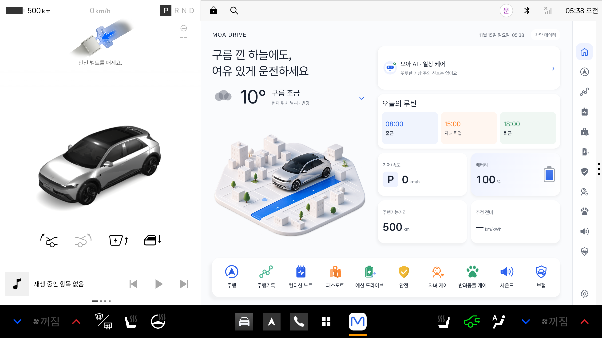
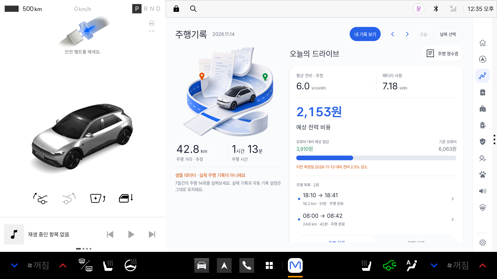

# 모아 드라이브 · MOA DRIVE

**운전을 넘어 일상을 케어하는 차량용 라이프 케어 앱**  

모아 드라이브는 차량 센터 디스플레이에서 길 안내, 주행 기록, 안전 정보와 가족의 일상을 함께 확인하는 Android Automotive 앱입니다. 차량의 속도·기어·배터리 신호를 화면과 기록에 연결하고, 반복되는 이동을 루틴으로 제안합니다.

## 제출 APK

- 버전: **1.0.0** (`versionCode 2`)
- 다운로드 파일명: **`CareMate_MOADRIVE_release.apk`**
- 공모전 제출 파일명: **`케어메이트_모아드라이브_release.apk`**
- [GitHub Release 및 APK 다운로드](https://github.com/chiltech/moa-drive/releases/tag/v1.0.0)
- [APK 위치·설치 안내](apk/README.md)

APK는 GitHub의 일반 저장소 파일 크기 제한을 초과하므로 **GitHub Releases**로 제공합니다. `apk/`에는 다운로드 경로와 SHA-256 검증 파일이 있습니다. GitHub가 업로드한 한글 자산명을 정규화해 다운로드 파일은 영문 이름으로 제공합니다. 제출 파일명이 필요하면 다운로드 후 `케어메이트_모아드라이브_release.apk`로 변경하세요. 파일명 변경은 APK 내용이나 SHA-256에 영향을 주지 않습니다. Release 태그가 가리키는 커밋이 해당 APK의 제출 소스입니다.

## 실행 화면





## 주요 기능

| 메뉴 | 기능 |
| --- | --- |
| 메인·모아 AI | 실시간 차량 정보, 날씨와 도시 애니메이션, 안전 브리핑, 출퇴근·자녀 픽업 루틴 안내 |
| 주행 | 카카오 내비게이션 SDK의 지도·목적지 검색·경로 비교, 길 안내, 과속·구간단속 안내, 주변 CCTV |
| 주행기록 | 주행 시작·종료 자동 감지, 날짜별 거리·시간·전비·배터리 사용량, 예상 전력 비용과 주행 영수증 |
| 컨디션 노트 | 평소 주행과 전력 사용을 비교하는 컨디션 리포트 |
| 드라이브 패스포트 | 방문 도시 지도, 지역 스탬프, 다음 도시의 관광지·맛집 추천 |
| 예산 드라이브 | 차량 주행가능거리와 배터리 여유를 바탕으로 코스 예산 확인 |
| 안전 | 주변 교통안전 정보, 10km 사고 접근 안내 시나리오, 안전운전 점수 기록 |
| 자녀 케어 | 프로필·학교 검색, NEIS 급식 정보, 일정·예방접종 알림, 대화 주제와 뉴스 원문 보기 |
| 반려동물 케어 | 강아지·고양이 프로필, 맞춤 케어, 병원·산책·동반 장소 추천과 관련 뉴스 |
| 사운드 | 차량 속도에 연동되는 가상 주행음, 서서히 커지는 음량과 정차 시 즉시 정음 |
| 보험 | 계약·할인 특약·서비스 횟수 시나리오, 안전점수·마일리지 안내, 임시운전자 가입 웹 화면 |
| 설정 | 라이트·다크 모드, 인트로, 지도·안전·루틴·주행기록·사운드 설정 |

각 서비스는 넓은 화면과 Pleos 화면 분할에 대응하며, 샘플 데이터 보기 버튼으로 기록이 없는 상태에서도 주요 화면을 확인할 수 있습니다. 구현된 내비게이션 제공자는 카카오이며 제공자 인터페이스를 분리했습니다.

## 실행 방법

### 제출 APK 실행

1. 아래 테스트 환경에 맞는 Pleos Connect 에뮬레이터를 실행합니다.
2. Release에서 APK를 내려받아 설치합니다.

```bash
adb devices -l
adb -s emulator-5554 install -r 'CareMate_MOADRIVE_release.apk'
adb -s emulator-5554 shell am start --user current \
  -n com.moagauge.pleos/.MainActivity
```

장치가 여러 개이면 실제 Pleos 장치 serial을 사용합니다. 첫 실행에서 위치·알림 권한을 허용하면 위치 기반 메뉴와 주행기록 알림을 이용할 수 있습니다. 기존 개발용 APK와 서명이 다르면 덮어쓰기 설치가 거부되므로 별도의 새 AVD에서 실행하세요. 기존 앱을 삭제하면 저장 기록도 사라집니다.

### 소스 빌드

1. JDK 17과 Android SDK Platform 35, Build Tools 35.0.0, Platform Tools를 준비합니다.
2. Android Studio에서 저장소 루트를 열거나 아래 명령을 실행합니다. `local.properties`의 `sdk.dir`에는 **본인 환경의 SDK 경로**를 지정합니다.
3. `secrets.properties.example`을 `secrets.properties`로 복사해 본인의 API 설정을 입력합니다.

```bash
cp local.properties.example local.properties
cp secrets.properties.example secrets.properties
# 위 두 파일의 경로와 키를 본인 환경에 맞게 수정
bash ./gradlew testDebugUnitTest assembleDebug
adb -s emulator-5554 install -r app/build/outputs/apk/debug/app-debug.apk
```

외부 Maven 저장소에 접근할 수 있는 네트워크가 필요합니다. SDK·에뮬레이터·Gradle 캐시는 저장소에 포함하지 않습니다.

### 본인 서명으로 release 빌드

`signing.properties.example`을 `signing.properties`로 복사하고 본인의 keystore 경로·alias·암호를 설정합니다. 해당 파일과 keystore는 Git에서 제외됩니다.

```bash
bash ./gradlew testReleaseUnitTest lintRelease assembleRelease
```

서명 파일을 저장소 외부에서 읽으려면 다음 옵션을 추가합니다.

```bash
bash ./gradlew assembleRelease \
  -Pmoa.signing.properties=/absolute/path/to/signing.properties
```

서명 설정이 있으면 출력은 `app/build/outputs/apk/release/app-release.apk`입니다. 설정이 없으면 unsigned APK가 생성되므로 제출·설치용으로 사용하지 마세요. 배포용 개인 서명키는 저장소에 포함하지 않습니다.

## 테스트 환경 및 필요한 설정

| 항목 | 사용 환경 |
| --- | --- |
| Pleos Connect | **2.1.0**, 시스템 이미지 revision 1 |
| OS | Android 14, API 34, `arm64-v8a` |
| 시스템 빌드 | `RELEASE.release_connect_v2.1.0 test-keys` |
| 에뮬레이터 도구 | Android Emulator 36.1.9.0, ADB 36.0.0 |
| 전체 디스플레이 | **2560 × 1440 px**, 160 dpi, 가로형 |
| 일반 앱 실행 영역 | **1682 × 1210 px** — OS 차량 영역·상하 시스템 영역 제외 |
| 분할 화면 | OS가 전달하는 창 크기에 따라 반응형 배치 |
| 빌드 환경 | macOS Apple Silicon, JDK 17.0.19, Gradle 8.10.2 |
| Android 빌드 | AGP 8.8.2, Kotlin 2.0.0, compile/target SDK 35, min SDK 28 |
| Pleos SDK | Vehicle 2.3.2, TextToSpeech 3.3.1 |
| 내비게이션 SDK | Kakao Mobility KNSDK UI 1.12.8-hotfix05 |
| 패키지명 | `com.moagauge.pleos` |

[Pleos 공식 개발 가이드](https://document.pleos.ai/docs/pleos-only/getting-started)를 따라 에뮬레이터와 Virtual Console을 설정하세요. Virtual Console의 속도·기어·배터리 신호를 변경하면 앱의 차량 정보와 연동됩니다. 전비·배터리 사용량 확인에는 속도뿐 아니라 배터리 에너지 신호도 변해야 합니다.

| 설정 | 용도 |
| --- | --- |
| `KAKAO_NATIVE_APP_KEY` | 카카오 지도·검색·길 안내. 콘솔에 패키지명과 사용 중인 서명 인증서의 키 해시 등록 필요 |
| `ITS_CCTV_API_KEY` | ITS CCTV 조회. 해당 서비스 승인과 호출 잔여량 필요 |
| `NEIS_API_KEY` | NEIS 학교·급식 조회용 선택 키. 빈 값이면 API의 키 없는 조회 범위 사용 |

Kakao 키 해시 등록 방법은 [공식 KNSDK 시작하기](https://developers.kakaomobility.com/guide/android-ui/start)를 참고하세요. 소스에는 실제 API 키가 없으며 예제 파일만 제공합니다. Android 클라이언트에 필요한 키는 로컬 빌드 시 APK에 포함되므로 자신의 서비스 설정과 허용 범위를 관리해야 합니다.

날씨·학교·뉴스·CCTV는 외부 서비스의 네트워크와 데이터 제공 상태에 영향을 받습니다. 앱 안의 보험 계약 표시·출동 요청, 루틴·일부 사고 알림은 공모전 체험 시나리오이며 출동을 실제 접수하지 않습니다. 임시운전자 가입은 보험사의 공식 웹 화면으로 연결합니다. 실시간 안전 정보가 없는 상태를 실제 사고 0건으로 간주하지 않습니다.

## 검증 및 구조

최종 release 검증 결과는 [검증 기록](docs/VERIFICATION.md)에 정리합니다.

```text
app/src/main/java/com/moagauge/pleos/
  vehicle/       Pleos 차량 신호와 전비 계산
  navigation/    제공자 인터페이스·카카오 지도·길 안내
  trips/         자동 주행기록과 비용 계산
  condition/     컨디션 비교
  passport/      방문 도시·스탬프
  budget/        배터리 예산
  safety/        날씨·교통안전·안전 점수
  care/          자녀·반려동물·학교·뉴스
  assist/        모아 AI·루틴·사고 접근 시나리오
  cctv/          CCTV 조회·재연결
  sound/         속도 연동 사운드
  insurance/     보험 화면·서비스 요청 흐름
  ui/            Compose 화면·테마·공통 레이어
app/src/test/    도메인·파서·정책 단위 테스트
apk/            제출 APK 다운로드 안내·체크섬
```

이미지·음원·폰트·지도 경계 자료의 출처는 [THIRD_PARTY_NOTICES.md](THIRD_PARTY_NOTICES.md)에 있습니다.
