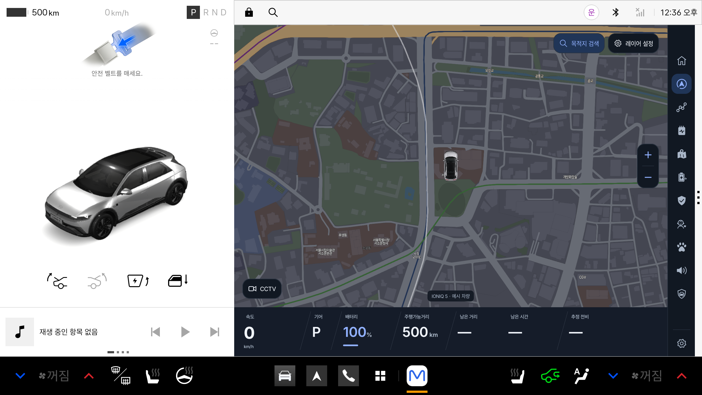

# 공모전 제출 release 검증

검증일: **2026-11-15 (KST)**

## 빌드·서명

```bash
bash ./gradlew testReleaseUnitTest lintRelease assembleRelease \
  --no-daemon --max-workers=2 -Pandroid.builder.sdkDownload=false \
  -Pmoa.signing.properties=/absolute/path/to/signing.properties
```

- 결과: `BUILD SUCCESSFUL`, 최종 전용 키 빌드 10분 17초. 60개 작업 중 18개 실행·42개 최신 상태 확인.
- 단위 테스트: **60 suites / 487 tests / 실패 0 / 오류 0**.
- Android Lint: **오류 0**, 경고 71개, 정보 7개. 경고가 없는 빌드라는 의미는 아닙니다.
- 패키지: `com.moagauge.pleos`, versionName `1.0.0`, versionCode `2`.
- `apkanalyzer manifest debuggable`: **false**.
- `apksigner verify --verbose --print-certs`: **검증 통과**, APK Signature Scheme v2.
- 별도 release 인증서: `CN=Care Mate, OU=MOA DRIVE, O=Care Mate, C=KR`, RSA 3072 bit.
- 인증서 SHA-256: `9093fb5074c1f3b5506de8ed32f09cd8a21a7c33e1f6c299f82c38538982f48c`.
- APK 크기: **229,806,715 bytes**.
- APK SHA-256: `fa1536f3edf2027e9ca23b1f4ef749a0d09bc303164b3ddcca4799c53b0980e7`.

## Pleos 에뮬레이터 실행

기존 개발용 설치와 별개의 새 Pleos Connect 2.1.0 AVD에서 release APK를 설치했습니다. 전체 디스플레이는 2560×1440 px / 160 dpi, 일반 앱 영역은 1682×1210 px입니다.

| 확인 항목 | 관찰한 결과 |
| --- | --- |
| 새 설치 | `adb install` 성공 |
| 앱 실행 | 스플래시 이후 메인 화면 진입 |
| 기본 차량 정보 | 정차 상태의 기어 P, 0 km/h, 배터리 100%, 주행가능거리 500 km 표시 |
| 주행기록 | 빈 상태 → 샘플 데이터 전환, 42.8 km·1시간13분·예상 전력 비용 2,153원 표시 |
| 주행 영수증 | 모달 열기와 내용 표시 |
| 테마 | 라이트·다크 전환 |
| 내비게이션 지도 | MOA DRIVE 전용 네이티브 앱 키를 반영한 최종 release에서 실제 서울시청 주변 지도 타일·차량 마커 표시 |
| 목적지 검색 | SDK에 `Seoul`을 검색하여 실제 결과 목록을 받고 `경복궁` 선택 |
| 경로 비교 | 추천·무료도로 우선·고속도로 우선 계산 완료 및 각 옵션 선택 확인. 이 짧은 구간에서는 세 옵션 모두 1.5 km·6분·통행료 0원으로 응답 |
| 길 안내 시작·종료 | 추천 경로에서 출발·다음 좌회전 안내와 지도 경로 표시. 앱의 내비게이션 포커스 획득을 확인한 뒤 `안내 종료`로 포커스 반환 확인 |
| 재실행 | 프로세스 종료 후 다시 실행하여 메인 진입 |

지도 검증에는 에뮬레이터에 서울 좌표(126.9780, 37.5665)를 입력했습니다. 실제 차량 주행이나 해당 장소 방문 기록을 의미하지 않습니다. 주행기록 샘플은 앱의 샘플 보기 기능을 사용했습니다. 이 확인은 기본 실행·화면 동작에 대한 스모크 테스트이며, 모든 실제 도로 상황이나 실차 인증을 대체하지 않습니다.

최종 내비게이션 검증은 일반 앱 영역에서 기어 P·0 km/h를 유지한 상태로 수행했습니다. 실제 두 앱을 동시에 띄운 분할 화면과 음성 출력은 이번 검증 범위에 포함하지 않았습니다. 검증 후 안내와 시험 GPS 반복 입력을 종료하고 라이트 모드 메인 화면으로 복귀했습니다.




## 소스 공개 점검

- `secrets.properties`, `signing.properties`, `local.properties`, keystore, SDK·에뮬레이터·Gradle 캐시, 빌드 중간 결과와 내부 검증 로그는 제외했습니다.
- 제출 소스에서 실제 설정 키·서명 암호 값과의 일치 항목이 없는 것을 확인했습니다.
- 앱에 필요한 소스·리소스·음원·글꼴 라이선스·Gradle wrapper를 포함했습니다.
- 소스 파일 중 100 MiB를 넘는 파일은 없습니다. 대용량 APK는 GitHub Releases에 게시합니다.
- 별도의 소스 재배포 라이선스는 추가하지 않았으며, 제3자 자산 출처는 [고지](../THIRD_PARTY_NOTICES.md)를 참고합니다.
