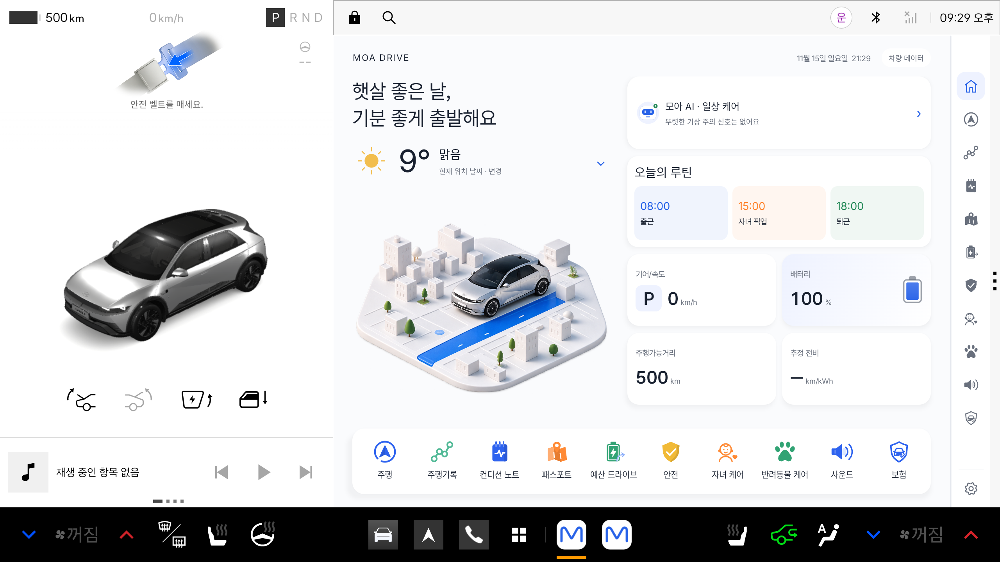
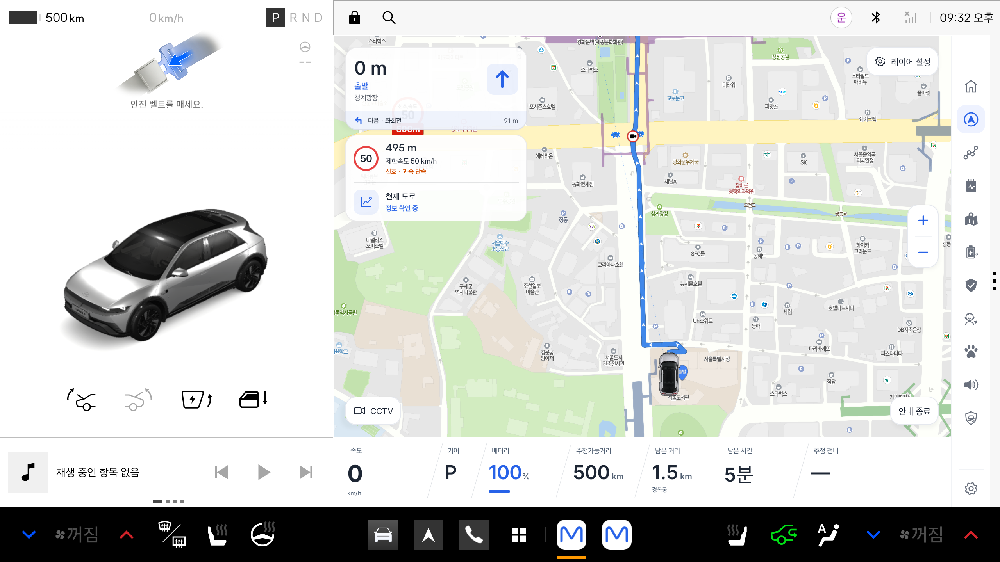

# 공모전 제출 release 1.0.1 검증

검증일: **2026-11-15 (KST)**

## 패키지 변경

Android application ID·namespace·소스 경로·컴포넌트 참조를 `com.moadrive.pleos`로 변경했습니다. 버전은 **1.0.1 / versionCode 3**입니다. 기존 API 키 값과 release 서명은 유지했습니다. 카카오의 MOA DRIVE 전용 등록 항목에서 허용 Android 패키지만 새 이름으로 변경하고 저장 상태를 다시 확인했습니다. 다른 플랫폼 키와 기존 모아게이지용 등록은 변경하지 않았습니다.

이전 패키지의 앱과 별도로 설치되며 저장 데이터는 자동 이전되지 않습니다.

## 빌드·서명

```bash
bash ./gradlew testReleaseUnitTest lintRelease assembleRelease \
  --no-daemon --max-workers=2 -Pandroid.builder.sdkDownload=false \
  -Pmoa.signing.properties=/absolute/path/to/signing.properties
```

- 결과: **BUILD SUCCESSFUL in 10m 22s**, 60개 작업 중 33개 실행·27개 최신 상태 확인.
- 단위 테스트: **60 suites / 487 tests / 실패 0 / 오류 0 / 건너뜀 0**. 모든 테스트가 새 패키지에서 실행됐습니다.
- Android Lint: **오류 0**, 경고 71개, 정보 7개.
- APK manifest: `com.moadrive.pleos`, versionName `1.0.1`, versionCode `3`, **debuggable=false**.
- APK DEX: 새 패키지의 MainActivity 확인, 이전 앱 패키지 클래스 참조 없음.
- APK Signature Scheme v2 검증 통과.
- 기존 release 인증서 유지: `CN=Care Mate, OU=MOA DRIVE, O=Care Mate, C=KR`, RSA 3072 bit.
- 인증서 SHA-256: `9093fb5074c1f3b5506de8ed32f09cd8a21a7c33e1f6c299f82c38538982f48c`.
- 파일: `CareMate_MOADRIVE_release.apk`, **229,806,715 bytes**.
- APK SHA-256: `ecbe8207782612179de1f1c0874e0b70030a257821bbd0b33eb250f448d04414`.

## Pleos 에뮬레이터 실행

개발용 AVD와 분리된 제출 검증용 Pleos Connect **2.1.0** AVD에서 확인했습니다. Android 14 / API 34 / arm64-v8a, Android Emulator 36.1.9.0, host GPU, 전체 화면 2560×1440 px / 160 dpi, 일반 앱 영역 1682×1210 px 환경입니다.

| 확인 항목 | 관찰한 결과 |
| --- | --- |
| 설치 | 서명된 새 release APK 설치 성공, 설치된 패키지·버전 재확인 |
| 메인 | 모아 AI 인사·메인 화면 표시, 기어 P·0 km/h·배터리 100%·주행가능거리 500 km 표시 |
| 지도 | 서울시청 주변 실제 카카오 지도 타일·차량 마커 표시 |
| 목적지 검색 | `Seoul` 검색 결과 수신 후 `경복궁` 선택 |
| 경로 계산 | 추천·무료도로 우선·고속도로 우선 모두 계산 완료. 해당 구간은 각각 1.5 km·5분·통행료 0원으로 응답 |
| 길 안내 | 안내 시작 후 출발·다음 회전 카드와 지도 경로 표시. `안내 종료` 실행 |
| 재실행 | 프로세스 종료 후 `COLD` 실행 `Status: ok`, 메인·모아 AI 표시 |
| 앱 오류 | 최종 실행 로그에서 `com.moadrive.pleos`의 fatal exception 없음 |

GPS 확인에는 에뮬레이터에 서울 좌표(126.9780, 37.5665)를 입력했습니다. 정차 상태의 설치·기본 실행·내비게이션 연결 확인이며, 실차 운행이나 전체 기능·음성 출력 검증을 의미하지 않습니다. 초기 AVD 실행에서는 Pleos 홈 런처의 task listener 중복 오류가 관찰되어 에뮬레이터를 재시작하고 host GPU 환경에서 최종 확인했습니다. 이 과정에서 APK를 변경하지 않았습니다.





## 소스 공개 점검

- 소스·리소스·빌드 파일 348개를 이전 제출본과 대조해 패키지·버전 변경 외의 의도하지 않은 변경이 없음을 확인했습니다.
- 메인·debug·test 소스의 패키지 선언과 디렉터리가 일치하며, Activity·Service·Receiver·Provider authority와 앱 내부 action 이름을 함께 변경했습니다.
- 개발 원본과 제출 소스의 앱 소스가 일치합니다.
- API 키·서명 암호·keystore·로컬 설정·SDK·AVD·빌드 캐시·내부 검증 로그는 공개 소스에서 제외했습니다. 실제 키·암호 값과 일치하는 공개 파일은 없습니다.
- 소스 파일 중 100 MiB 초과 파일은 없습니다. 대용량 APK는 [GitHub Release](https://github.com/chiltech/moa-drive/releases/tag/v1.0.1)로 제공합니다.
- 제3자 자산 출처는 [고지](../THIRD_PARTY_NOTICES.md)를 참고합니다.
